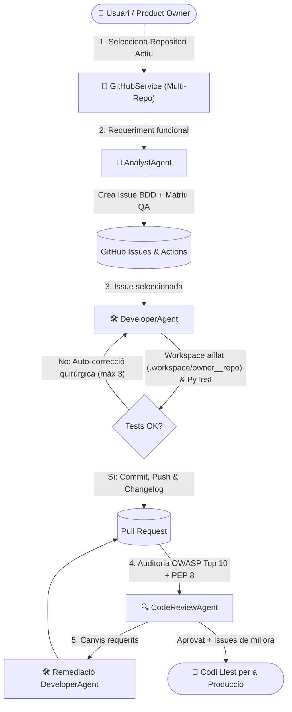

# 🤖 AI Developer Agent

**AI Developer Agent** és una plataforma multi-agent autònoma basada en Intel·ligència Artificial (Google Gemini) i integrada nativament amb GitHub que automatitza el cicle complet d'enginyeria de programari sobre múltiples repositoris: adreçada a equips de desenvolupament, Product Owners i enginyers DevOps, transforma requeriments funcionals en Issues amb criteris BDD i matriu de QA, desenvolupa codi i workflows de GitHub Actions en workspaces aïllats validats amb PyTest, audita les Pull Requests sota estàndards PEP 8 i seguretat OWASP Top 10, i n'executa la remediació automàtica.

---

## 📐 Arquitectura d'Alt Nivell

El sistema s'estructura al voltant d'un menú interactiu multi-repositori i tres agents especialitzats que hereten d'una classe base comuna ([`BaseAgent`](src/agents/base_agent.py)), recolzats en capes de servei ([`GitHubService`](src/services/github_service.py), [`LLMService`](src/services/llm_service.py)), esquemes Pydantic i utilitats transversals:



### Components Principals
1. **Gestió Multi-Repositori (`GitHubService`)**: Permet seleccionar dinàmicament el repositori de GitHub actiu des del menú interactiu, descobrir repositoris disponibles i gestionar Issues, branques, Pull Requests i workflows de desplegament (`.github/workflows/*.yml`).
2. **Classe Base d'Agents (`BaseAgent`)**: Centralitza la injecció de dependències i la inicialització *lazy* dels serveis, la càrrega de la política de codi ([`docs/code_policy.md`](docs/code_policy.md)) i el registre d'auditoria estructurat en JSON ([`AgentLogger`](src/utils/logger.py)).
3. **Agent Analista (`AnalystAgent`)**: Transforma requeriments en llenguatge natural en Issues de GitHub amb Històries d'Usuari, Criteris d'Acceptació BDD (*Given-When-Then*) i Matriu de Proves QA.
4. **Agent Desenvolupador (`DeveloperAgent`)**: Prepara un workspace aïllat per repositori i Issue, sanejant credencials de l'entorn, descarrega la branca principal o de la PR, genera/modifica codi i tests amb *Structured Outputs*, executa PyTest en 2 fases i obre la Pull Request.
5. **Agent Revisor de Codi (`CodeReviewAgent`)**: Audita el *diff* d'una Pull Request verificant PEP 8, tipat PEP 484, docstrings Google Style, complexitat algorísmica i seguretat OWASP Top 10, publicant l'informe a GitHub i creant Issues de millora contínua (*enhancement*).
6. **Resiliència Multi-Model LLM (`LLMService`)**: Opera amb `gemini-2.5-flash` com a model primari i *fallback* automàtic a `gemini-2.5-flash-lite` amb reintents exponencials (`tenacity`).

---

## ⚡ Quickstart Reproduïble (< 5 minuts)

### 1. Requisits Previs
* **Python**: Versió `3.10` o superior.
* **Git**: Instal·lat i configurat a l'entorn local.
* **GitHub Personal Access Token**: Amb permisos sobre els repositoris de treball (`repo`, `issues`, `pull_requests`, `workflow`).
* **Google Gemini API Key**: Clau activa de Google AI Studio.

### 2. Instal·lació Pas a Pas

```bash
# 1. Clona el repositori i accedeix al directori
git clone https://github.com/emasnou/ai-developer-agent.git
cd ai-developer-agent

# 2. Crea i activa l'entorn virtual
python3 -m venv .venv
source .venv/bin/activate

# 3. Instal·la el projecte en mode editable amb les eines de desenvolupament i QA
pip install -e ".[dev]"

# 4. Crea el fitxer de configuració d'entorn a partir de la plantilla documentada
cp .env.example .env
```

Edita el fitxer `.env` amb les teves credencials (consulta tots els detalls i formats a [`.env.example`](.env.example)):

```env
GITHUB_TOKEN=ghp_el_teu_token_de_github
GITHUB_REPO=usuari_o_org/repositori-per-defecte
GITHUB_REPOS=usuari_o_org/repo-backend,usuari_o_org/repo-frontend
GEMINI_API_KEY=la_teva_clau_api_de_gemini
APP_SECRET_KEY=clau_secreta_robusta_de_minim_32_caracters_123456
```

### 3. Execució de l'Agent

```bash
# Inicia el menú interactiu mitjançant l'script operatiu de bin/ o l'entrypoint CLI:
./bin/ai-agent
# O bé: ai-agent / python3 -m src.main
```

### 4. Scripts Operatius (`bin/`), Tests, Qualitat i Manteniment

El directori [`bin/`](bin/README.md) conté scripts en Bash amb paràmetres d'entrada (`--help`) per executar totes les funcionalitats del projecte:

```bash
# 1. Executar l'agent (menú interactiu o acció directa per paràmetres)
./bin/ai-agent --help
./bin/ai-agent --repo emasnou/ai-developer-agent --action develop --issue 12

# 2. Executar tota la suite de qualitat, tipat, docstrings AST i tests unitaris (PyTest)
./bin/ai-quality --all

# 3. Sincronitzar automàticament referència d'API, índex d'ADRs i portal MkDocs
./bin/ai-docs --all

# 4. Actualitzar CHANGELOG.md des de Git o publicar una nova versió SemVer
./bin/ai-changelog
./bin/ai-changelog --release 0.4.0

# 5. Llistar o crear nous Architecture Decision Records (ADRs) a docs/adr/
./bin/ai-adr --list
./bin/ai-adr --new "Títol de la decisió" --status Acceptat
```

---

## 💻 Guia d'Ús del Menú Interactiu

En iniciar `ai-agent`, la capçalera mostra sempre el **repositori actiu** sobre el qual s'executaran totes les operacions:

```text
============================================================
📂 REPOSITORI ACTIU: usuari_o_org/repo-backend
============================================================
🤖 AGENT D'IA PER A DESENVOLUPAMENT AUTÒNOM DE PROGRAMARI
============================================================
1. [Repositori] Seleccionar el repositori de GitHub sobre el qual treballar
2. [Analista] Crear una nova Issue a GitHub des d'un requeriment
3. [Desenvolupador] Desenvolupar i provar una Issue de GitHub
4. [Code Reviewer] Auditar una Pull Request (Nomenclatura + OWASP Top 10)
5. [Remediació] Refactoritzar i corregir una PR segons el Code Review
6. Sortir
```

* **Opció 1 — Selecció de Repositori**: Llista els repositoris configurats a `GITHUB_REPOS` i els accessibles pel token de GitHub. En triar-ne un, passa a ser el repositori actiu a la capçalera del menú.
* **Opció 2 — Mode Analista**: Redacta la Història d'Usuari, els criteris BDD i la matriu de QA a partir d'un requeriment en llenguatge natural i crea la Issue al repositori seleccionat.
* **Opció 3 — Mode Desenvolupador**: Sincronitza el repositori seleccionat a `.workspace/<owner__repo>/issue_<num>`, crea la branca `feature/issue-<num>`, implementa el codi, workflows i tests, valida amb PyTest (fins a 3 intents d'auto-correcció) i obre la Pull Request.
* **Opció 4 — Mode Code Reviewer**: Audita el *diff* d'una Pull Request oberta segons [`docs/code_policy.md`](docs/code_policy.md), publica el veredicte a GitHub i crea Issues de millora futura (*enhancement*).
* **Opció 5 — Mode Remediació**: Descarrega la branca d'una PR amb canvis requerits, refactoritza els fitxers seguint els comentaris del Code Review, verifica que tots els tests passin i actualitza la PR.

---

## 📁 Estructura del Projecte

```text
ai-developer-agent/
├── .github/
│   ├── ISSUE_TEMPLATE/           # Plantilles oficials d'Issues (Feature, Millora, Bug)
│   ├── workflows/
│   │   ├── ci.yml                # Pipeline CI/CD (Ruff, Docstrings AST, Mypy i PyTest)
│   │   ├── docs.yml              # Sincronització automàtica de docs i portal MkDocs Pages
│   │   └── changelog.yml         # Automatització d'actualització de CHANGELOG.md
│   └── pull_request_template.md  # Plantilla oficial de Pull Requests
├── bin/
│   ├── _common.sh                # Resolució d'entorn (.venv) i utilitats compartides
│   ├── ai-agent                  # Execució de l'agent i subagents (menú o paràmetres CLI)
│   ├── ai-docs                   # Sincronització AST de documentació i portal MkDocs
│   ├── ai-changelog              # Gestió automàtica de CHANGELOG.md i versions SemVer
│   ├── ai-quality                # Suite unificada de qualitat (Ruff, Mypy, Bandit, PyTest)
│   └── ai-adr                    # Creació i indexació d'Architecture Decision Records
├── docs/
│   ├── adr/                      # Registre i plantilla oficial d'ADRs (0000, 0001, 0002...)
│   ├── reference/                # Referència tècnica d'API auto-generada (index.md)
│   ├── index.md                  # Pàgina principal del portal MkDocs (marc Diátaxis)
│   ├── Politica_Documentacio.md  # Política de documentació Docs-as-Code en 5 nivells
│   └── code_policy.md            # Política de codi, estil Google Docstrings, OWASP Top 10 i PyTest
├── src/
│   ├── agents/
│   │   ├── base_agent.py         # Classe base amb DI, logging estructurat i context de repositori
│   │   ├── analyst_agent.py      # Agent Analista (Product Owner & BDD)
│   │   ├── developer_agent.py    # Agent Desenvolupador (Coder, Tester & Workspace aïllat)
│   │   └── code_review_agent.py  # Agent Auditor de Codi (Code Reviewer)
│   ├── prompts/                  # Plantilles de prompts de sistema per a cada agent
│   ├── schemas/                  # Models Pydantic per a Structured Outputs del LLM
│   ├── services/                 # Clients de GitHub (PyGithub) i Google Gemini (GenAI)
│   ├── utils/
│   │   ├── changelog_updater.py  # Generador i actualitzador automàtic de CHANGELOG.md
│   │   ├── config.py             # Configuració immutable (AppConfig) i validació d'entorn
│   │   ├── json_parser.py        # Utilitats de neteja, reparació i validació JSON/YAML
│   │   └── logger.py             # Sistema de logging JSON estructurat amb rotació
│   ├── main.py                   # Interfície CLI interactiva multi-repositori
│   └── password_reset.py         # Mòdul de seguretat per a restabliment de contrasenyes (OWASP/NIST)
├── tests/
│   ├── unit/                     # Bateria de tests unitaris (100% offline amb tmp_path i mocks)
│   └── integration/              # Tests d'integració amb serveis externs (GitHub / Gemini)
├── CHANGELOG.md                  # Historial de versions (Keep a Changelog & SemVer)
├── CONTRIBUTING.md               # Guia d'estàndards, branques, Conventional Commits i PRs
├── pyproject.toml                # Configuració PEP 621, scripts CLI, PyTest, Ruff i Mypy
├── requirements.txt              # Dependències de producció i desenvolupament
├── .env.example                  # Contracte documentat de variables d'entorn
└── README.md
```

---

## 🛡️ Governança i Documentació Relacionada

* **[`docs/Politica_Documentacio.md`](docs/Politica_Documentacio.md)**: Marc de treball *Docs-as-Code* aplicat al projecte.
* **[`docs/code_policy.md`](docs/code_policy.md)**: Directrius de nomenclatura PEP 8, Google Docstrings, OWASP Top 10 i PyTest.
* **[`CONTRIBUTING.md`](CONTRIBUTING.md)**: Flux de branques Git, *Conventional Commits* i llista de control per a Pull Requests.
* **[`CHANGELOG.md`](CHANGELOG.md)**: Historial de versions i registre automatitzat de canvis.
