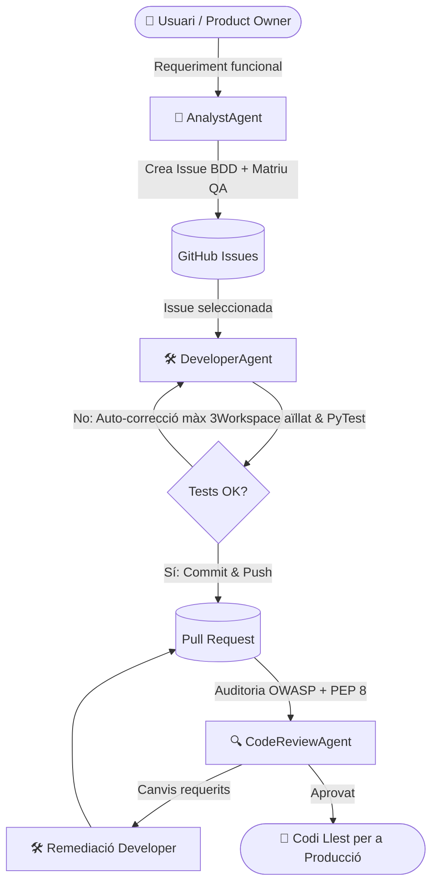

# 🤖 AI Developer Agent

Un agent autònom basat en Intel·ligència Artificial dissenyat per automatitzar el cicle complet de vida del desenvolupament de programari: des de l'anàlisi de requisits i la creació de tasques estructurades a GitHub amb matriu de qualitat (QA), fins a la generació de codi multi-fitxer, l'execució i auto-correcció mitjançant tests automatitzats, l'obertura de Pull Requests i l'auditoria de seguretat i bones pràctiques de codi.

---

## 📐 Arquitectura del Sistema

El sistema s'estructura en diversos agents especialitzats que hereten d'una classe base comuna (`BaseAgent`) i es recolzen en capes de servei, esquemes Pydantic i utilitats transversals:



1. **Classe Base d'Agents (`BaseAgent`)**: Centralitza la injecció de dependències i la inicialització *lazy* dels serveis (`LLMService`, `GitHubService`), la càrrega de la política de codi (`docs/code_policy.md`) i el registre d'auditoria estructurat en JSON (`AgentLogger`).
2. **Agent Analista (`AnalystAgent`)**: Transforma requeriments d'usuari en especificacions detallades a GitHub Issues amb Històries d'Usuari, Criteris d'Acceptació BDD (*Given-When-Then*) i Matriu de Proves QA.
3. **Agent Desenvolupador (`DeveloperAgent`)**: Prepara un workspace aïllat amb sanejament de secrets d'entorn, descarrega l'estat de la branca corresponent (`main` o `feature/issue-<num>`), genera/modifica múltiples fitxers de codi i tests, i publica automàticament la Pull Request un cop validada.
4. **Agent Revisor de Codi (`CodeReviewAgent`)**: Audita automàticament els canvis d'una PR analitzant nomenclatura (PEP 8, tipat estàtic, docstrings Google Style), eficiència d'algoritmes i vulnerabilitats de seguretat (OWASP Top 10). Publica l'informe a la PR i proposa noves Issues de millora a futur (*enhancement*).
5. **Resiliència Multi-Model LLM (`LLMService`)**:
   - Model principal: `gemini-3.8-flash`.
   - Model de reserva (*fallback* automàtic): `gemini-3.5-flash-lite` davant pics d'alta demanda (HTTP 503 / ServerError) gestionat amb reintents exponencials (`tenacity`).
6. **Sortides Estructurades i Parser Resilient (`src/schemas/` i `src/utils/json_parser.py`)**: Esquemes Pydantic estrictes combinats amb un parser multi-nivell capaç de reparar blocs Markdown, cometes triples no escapades, seqüències d'escapament invàlides i estructures YAML/JSON híbrides.
7. **Execució de Tests Intel·ligent i Aïllada**:
   - **Execució en 2 fases**: Prova primer els tests nous o modificats (`-x --tb=short`) i posteriorment la regressió de tests unitaris, aïllant la suite de dependències externes de xarxa i eliminant credencials sensibles de l'entorn del subprocés.
   - **Fusió quirúrgica**: Durant els cicles d'auto-correcció, es fusionen els canvis preservant els fitxers correctes previs.

---

## 📁 Estructura del Projecte

```text
ai-developer-agent/
├── .github/
│   └── workflows/
│       └── ci.yml                # Pipeline CI/CD (Ruff, Mypy i PyTest en Python 3.10/3.11)
├── docs/
│   └── code_policy.md            # Política de codi, estil Google Docstrings, OWASP Top 10 i PyTest
├── src/
│   ├── agents/
│   │   ├── __init__.py
│   │   ├── base_agent.py         # Classe base amb DI, logging estructurat i política de codi
│   │   ├── analyst_agent.py      # Agent Analista (Product Owner)
│   │   ├── developer_agent.py    # Agent Desenvolupador (Coder, Tester & Workspace)
│   │   └── code_review_agent.py  # Agent Auditor de Codi (Code Reviewer)
│   ├── prompts/
│   │   ├── __init__.py
│   │   ├── analyst_prompts.py    # Prompts de l'agent analista
│   │   ├── developer_prompts.py  # Prompts i regles d'enginyeria del desenvolupador
│   │   └── review_prompts.py     # Prompts per a revisió de codi i millores
│   ├── schemas/
│   │   ├── __init__.py
│   │   └── agent_schemas.py      # Models Pydantic per a Structured Outputs del LLM
│   ├── services/
│   │   ├── __init__.py
│   │   ├── github_service.py     # Integració nativa amb l'API de GitHub (PyGithub)
│   │   └── llm_service.py        # Client de Gemini amb fallback i reintents automàtics
│   ├── utils/
│   │   ├── __init__.py
│   │   ├── config.py             # Configuració immutable (AppConfig) i validació d'entorn
│   │   ├── json_parser.py        # Utilitats de neteja, reparació i validació JSON/YAML
│   │   └── logger.py             # Sistema de logging JSON estructurat amb rotació (AgentLogger)
│   ├── main.py                   # Interfície CLI interactiva i gestors de menú
│   └── password_reset.py         # Mòdul de seguretat per a restabliment de contrasenyes (OWASP/NIST)
├── tests/
│   ├── unit/                     # Bateria de tests unitaris (100% offline)
│   │   ├── test_json_parsing.py  # Validació del parser JSON, BaseAgent i aïllament d'entorn
│   │   ├── test_logger.py        # Validació de format JSON i rotació de logs amb tmp_path
│   │   └── test_password_reset.py# Tests de seguretat, criptografia, TOCTOU i rate limiting
│   └── integration/              # Tests d'integració amb serveis externs (GitHub / Gemini)
│       ├── test_github_connection.py
│       └── test_llm_connection.py
├── CHANGELOG.md                  # Historial de versions i canvis del projecte
├── CONTRIBUTING.md               # Guia d'estàndards i flux de contribució
├── pyproject.toml                # Configuració PEP 621, scripts CLI, PyTest, Ruff i Mypy
├── requirements.txt              # Dependències de producció i desenvolupament
├── .env.example                  # Plantilla de variables d'entorn
└── README.md
```

---

## 🚀 Configuració i Instal·lació

### 1. Requisits Previs
* **Python**: Versió 3.10 o superior.
* **Compte de GitHub**: Un repositori públic o privat on executar les tasques.
* **GitHub Token**: Un *Personal Access Token (classic o fine-grained)* amb permisos de lectura i escriptura sobre el repositori (`repo`, `issues`, `pull-requests`).
* **Google Gemini API Key**: Clau d'accés a l'API de Google GenAI.

### 2. Instal·lació de Dependències
Clona el repositori i instal·la el projecte en mode editable amb les eines de desenvolupament:

```bash
git clone https://github.com/emasnou/ai-developer-agent.git
cd ai-developer-agent
pip install -e ".[dev]"
# O bé mitjançant requirements.txt:
pip install -r requirements.txt
```

### 3. Configuració de Variables d'Entorn
Crea el teu fitxer `.env` a partir de la plantilla d'exemple:

```bash
cp .env.example .env
```

Edita el fitxer `.env` i configura les credencials:

```env
GITHUB_TOKEN=ghp_el_teu_token_de_github
GITHUB_REPO=usuari_o_org/nom-del-repositori
GEMINI_API_KEY=la_teva_clau_api_de_gemini
APP_SECRET_KEY=clau_secreta_robusta_de_minim_32_caracters_123456
```

---

## 💻 Ús de l'Agent

Pots iniciar el panell de control interactiu utilitzant l'script instal·lat o executant el mòdul principal:

```bash
ai-agent
# O bé directament amb Python:
python3 -m src.main
```

El menú principal et permetrà escollir entre les diferents capacitats del cicle autònom:

```text
============================================================
🤖 AGENT D'IA PER A DESENVOLUPAMENT AUTÒNOM DE PROGRAMARI
============================================================
1. [Analista] Crear una nova Issue a GitHub des d'un requeriment
2. [Desenvolupador] Desenvolupar i provar una Issue de GitHub
3. [Code Reviewer] Auditar una Pull Request (Nomenclatura + OWASP Top 10)
4. [Remediació] Refactoritzar i corregir una PR segons el Code Review
5. Sortir
```

### 1. Mode Analista (Opció 1)
Introdueix un títol i una descripció funcional en llenguatge natural. L'agent analista redactarà la Història d'Usuari completa i la matriu de proves de QA, obrint directament la tasca a GitHub amb les etiquetes corresponents (`enhancement`, `agent-analyst`).

### 2. Mode Desenvolupador (Opció 2)
Mostra el llistat d'Issues obertes al repositori. En seleccionar-ne una:
1. Descarrega l'estat oficial de `main` a un workspace aïllat `.workspace/issue_<num>`.
2. Crea una branca remota `feature/issue-<num>`.
3. Genera el codi font i tests unitaris necessaris utilitzant Structured Outputs.
4. Executa PyTest de forma automàtica en un entorn net de secrets. Si algun test falla, activa l'auto-correcció quirúrgica (fins a 3 cicles).
5. Un cop passats tots els tests, fa *commit*, *push* i obre una Pull Request detallada a GitHub.

### 3. Mode Code Reviewer (Opció 3)
Audita el *diff* d'una Pull Request oberta segons la política interna [`docs/code_policy.md`](docs/code_policy.md):
* **Nomenclatura i estil:** PEP 8, Type Hints complets i Docstrings Google Style.
* **Seguretat:** Validacions OWASP Top 10 (evitació d'injeccions, gestió segura de secrets, protecció contra atacs de repetició).
* **Rendiment:** Evitació de bucles innecessaris o operacions bloquejants.
* **Publicació:** Deixa un informe complet com a comentari a la PR i genera automàticament noves Issues per a suggeriments o millores futures.

### 4. Mode Remediació (Opció 4)
Llegeix els comentaris i canvis requerits d'una PR auditada prèviament, descarrega el contingut actual de la branca de la PR (`feature/issue-<num>`) al workspace aïllat, refactoritza els fitxers necessaris, valida que els tests continuïn passant i actualitza la branca de la PR.

---

## 🧪 Qualitat de Codi i Execució de Tests

El projecte disposa de validacions d'estil, tipat estàtic i proves automatitzades:

```bash
# Execució de tests unitaris (no requereix credencials externes)
pytest -v tests/unit/

# Execució amb informe de cobertura de codi
pytest -v tests/unit/ --cov=src --cov-report=term-missing

# Linting i comprovació d'estil amb Ruff
ruff check src/ tests/

# Verificació de tipat estàtic amb Mypy
mypy src/
```

---

## 🛡️ Polítiques de Codi i Contribució

* Consulta [`docs/code_policy.md`](docs/code_policy.md) per conèixer les directrius de nomenclatura, docstrings, seguretat OWASP Top 10 i disseny de tests amb `pytest`.
* Consulta [`CONTRIBUTING.md`](CONTRIBUTING.md) per a la guia de flux de treball Git, *Conventional Commits* i creació de nous agents.
* Consulta [`CHANGELOG.md`](CHANGELOG.md) per revisar l'historial de canvis del projecte.
