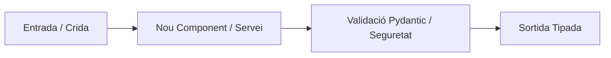

# ADR-0000: [Títol Breu i Descriptiu de la Decisió d'Arquitectura]

> **Instruccions per a l'Agent d'IA (`DeveloperAgent` / `AnalystAgent` / `CodeReviewAgent`):**
> Utilitza aquesta plantilla per documentar qualsevol decisió arquitectònica rellevant presa durant l'anàlisi, desenvolupament o remediació d'una Issue o Pull Request. Desa el fitxer a `docs/adr/NNNN-titol-en-kebab-case.md` substituint els camps entre claudàtors `[...]` per la informació tècnica exacta.

## 📋 Metadades i Traçabilitat de l'Agent d'IA

| Camp | Valor |
| :--- | :--- |
| **ID d'ADR** | `ADR-NNNN` |
| **Estat** | `Proposat` \| `Acceptat` \| `Obsolet` \| `Substituït per ADR-XXXX` |
| **Data** | `YYYY-MM-DD` |
| **Agent Autor** | `[AnalystAgent / DeveloperAgent / CodeReviewAgent / Humà]` |
| **Model LLM Emprat** | `[ex: gemini-2.5-flash / gemini-2.5-flash-lite]` |
| **Repositori Actiu** | `[propietari/nom-del-repositori]` |
| **Issue / PR Vinculada** | `[# Número d'Issue o Pull Request]` |
| **Impacte de Seguretat (OWASP)** | `[Baix / Mitjà / Alt — Especificar categoria ex: A01, A02, A03, A07]` |

---

## 1. Context i Problema Tècnic

[Descriu de manera objectiva el context tècnic i funcional que motiva aquesta decisió:]
- **Requeriment d'origen:** Quina necessitat funcional o problema tècnic planteja la Issue o l'auditoria de codi?
- **Estat actual del repositori:** Quins mòduls existents es veuen afectats i quines limitacions presenten?
- **Restriccions aplicables:** Quines regles de [`docs/code_policy.md`](../code_policy.md) condicionen el disseny (SRP, tipat PEP 484, aïllament de secrets, límits de temps d'execució)?

---

## 2. Factors de Decisió (Architectural Drivers)

* **[Factor 1 — Seguretat i Aïllament]:** [Ex: Garantir que cap operació no pugui sortir del workspace ni exposar tokens a subprocessos.]
* **[Factor 2 — Simplicitat i SRP]:** [Ex: Mantenir funcions $\le$ 35 línies amb alta cohesió i baix acoblament.]
* **[Factor 3 — Testabilitat Offline]:** [Ex: Permetre l'execució de tests unitaris amb `pytest`, `tmp_path` i `MagicMock` sense connexió de xarxa.]
* **[Factor 4 — Rendiment i Resiliència]:** [Ex: Complexitat temporal òptima i tolerància a errors d'APIs externes.]

---

## 3. Decisió d'Arquitectura Presa per l'Agent IA

### 3.1. Resum de la Solució Escollida
[Explica clarament quina decisió tècnica o patró de disseny ha pres l'agent i **per què** és l'opció més adequada per resoldre el problema.]

### 3.2. Diagrama d'Arquitectura / Flux (Mermaid)

### 3.3. Components i Fitxers Afectats
* `[src/ruta/fitxer.py]`: [Rol del mòdul o classe creada/modificada i responsabilitat única.]
* `[tests/unit/test_fitxer.py]`: [Cobertura de tests unitaris associada.]

---

## 4. Alternatives Considerades i Descartades

| Alternativa Avaluada | Avantatges (Pros) | Inconvenients (Contres) | Motiu de Descart per l'Agent IA |
| :--- | :--- | :--- | :--- |
| **Opció A (Escollida):** `[Nom de l'opció]` | `[Pros principals]` | `[Cost assumible]` | **Seleccionada** pel seu equilibri entre seguretat, netedat i testabilitat. |
| **Opció B:** `[Alternativa 1]` | `[Pros]` | `[Contres tècnics o de seguretat]` | `[Explicar per què s'ha descartat: ex. acoblament alt, risc OWASP, complexitat excessiva]` |
| **Opció C:** `[Alternativa 2]` | `[Pros]` | `[Contres]` | `[Explicar per què s'ha descartat]` |

---

## 5. Conseqüències, Trade-offs i Anàlisi de Seguretat (OWASP Top 10)

### 5.1. Conseqüències Positives
* ✅ `[Benefici directe 1 en mantenibilitat, seguretat o escalabilitat]`
* ✅ `[Benefici directe 2 en cobertura de proves o claredat de contractes]`

### 5.2. Trade-offs i Deute Tècnic Assumit
* ⚠️ `[Limitació coneguda o compromís tècnic assumit i com es mitiga]`

### 5.3. Avaluació de Seguretat (OWASP Top 10)
* **Vectors mitigats:** `[Ex: A01 Path Traversal mitigat amb Path.is_relative_to; A03 Injection mitigat evitant shell=True]`.
* **Gestió de secrets i dades sensibles:** `[Confirmació que no s'exposen credencials ni dades personals als logs o respostes]`.

---

## 6. Verificació Automatitzada i Evidència de QA (PyTest)

* **Tests unitaris executats:** `[Llista de tests a tests/unit/ que validen aquesta decisió]`
* **Aïllament verificat:** `[Confirmació d'ús de tmp_path i mocks sense efectes secundaris]`
* **Criteri d'acceptació per al `CodeReviewAgent`:** `[Punts clau que l'auditor ha de comprovar a la Pull Request]`

