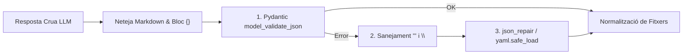

# ADR-0001: Sortides Estructurades amb Pydantic i Parser Multi-Nivell Resilient

## 📋 Metadades i Traçabilitat de l'Agent d'IA

| Camp | Valor |
| :--- | :--- |
| **ID d'ADR** | `ADR-0001` |
| **Estat** | `Acceptat` |
| **Data** | `2026-10-25` |
| **Agent Autor** | `DeveloperAgent` / Equip d'Arquitectura |
| **Model LLM Emprat** | `gemini-2.5-flash` (amb fallback `gemini-2.5-flash-lite`) |
| **Repositori Actiu** | `emasnou/ai-developer-agent` |
| **Issue / PR Vinculada** | `Estandardització Fase 2` |
| **Impacte de Seguretat (OWASP)** | `Mitjà — A04: Insecure Design (Validació d'esquemes d'entrada/sortida)` |

---

## 1. Context i Problema Tècnic

- **Requeriment d'origen:** Els agents autònoms (`DeveloperAgent` i `CodeReviewAgent`) necessiten rebre respostes estrictament estructurades del model LLM (llistes de fitxers amb `path`, `action` i `content`, o veredictes d'auditoria amb `approved` i `report`).
- **Estat previ:** Tot i configurar `response_mime_type="application/json"` i `response_schema` a l'SDK de Google GenAI, quan el codi generat conté docstrings multilínia amb cometes triples (`"""`), barres invertides d'expressions regulars (`\d`, `\s`) o blocs Markdown embolcallats, la resposta crua pot fallar en un `json.loads()` directe.
- **Restriccions aplicables:** Complir el Principi de Responsabilitat Única (SRP) de [`docs/code_policy.md`](../code_policy.md), evitant duplicar lògica de parseig entre els diferents agents.

---

## 2. Factors de Decisió (Architectural Drivers)

* **Fiabilitat i Resiliència:** Evitar que un error menor d'escapament JSON malbarati una resposta vàlida del model LLM i consumeixi cicles de reintent innecessaris.
* **Validació Estricta de Contractes:** Garantir que el resultat final compleixi sempre l'estructura tipada esperada pels agents.
* **Reutilització i SRP:** Centralitzar la lògica de sanejament i parseig en un únic mòdul transversal.

---

## 3. Decisió d'Arquitectura Presa per l'Agent IA

### 3.1. Resum de la Solució Escollida
S'ha decidit combinar **Structured Outputs basats en models Pydantic** ([`src/schemas/agent_schemas.py`](../../src/schemas/agent_schemas.py)) amb un **Parser Multi-Nivell Resilient centralitzat** ([`src/utils/json_parser.py`](../../src/utils/json_parser.py)) que aplica una cadena de recuperació progressiva:
1. Neteja de tancaments Markdown i extracció del primer bloc `{...}` balancejat.
2. Validació directa amb `DeveloperPlan.model_validate_json()`.
3. Reparació de cometes triples no escapades i seqüències d'escapament invàlides (`\s`, `\d`).
4. Recuperació amb `json_repair` i *fallback* final amb `yaml.safe_load`.

### 3.2. Diagrama d'Arquitectura / Flux (Mermaid)

### 3.3. Components i Fitxers Afectats
* [`src/schemas/agent_schemas.py`](../../src/schemas/agent_schemas.py): Definició dels contractes `FileItem`, `DeveloperPlan`, `CodeReviewResponse` i `ImprovementsResponse`.
* [`src/utils/json_parser.py`](../../src/schemas/agent_schemas.py): Implementació del pipeline de parseig i normalització.
* [`tests/unit/test_json_parsing.py`](../../tests/unit/test_json_parsing.py): Bateria de proves unitàries amb casos límit de JSON malformat.

---

## 4. Alternatives Considerades i Descartades

| Alternativa Avaluada | Avantatges (Pros) | Inconvenients (Contres) | Motiu de Descart per l'Agent IA |
| :--- | :--- | :--- | :--- |
| **Opció A (Escollida):** Pydantic + Parser Multi-Nivell (`json_parser.py`) | Alta taxa d'èxit en el primer intent i contracte fortament tipat. | Manteniment d'una utilitat de reparació pròpia. | **Seleccionada** per maximitzar la resiliència del cicle autònom. |
| **Opció B:** Només `json.loads()` estricte i reintentar crida al LLM | Codi més curt. | Cost elevat en latència i quota d'API quan el LLM inclou docstrings Python llargs. | Descartada per ineficiència i fragilitat en generació multi-fitxer. |
| **Opció C:** Delimitadors XML personalitzats en text pla | Evita escapar cometes JSON. | Perd la validació nativa de `response_schema` de l'API de Gemini. | Descartada per pèrdua del contracte tipat natiu del model. |

---

## 5. Conseqüències, Trade-offs i Anàlisi de Seguretat (OWASP Top 10)

### 5.1. Conseqüències Positives
* ✅ Reducció dràstica d'errors de parseig en fitxers Python amb docstrings Google Style i expressions regulars.
* ✅ Eliminació de codi duplicat entre `DeveloperAgent` i `CodeReviewAgent`.

### 5.2. Trade-offs i Deute Tècnic Assumit
* ⚠️ El *fallback* YAML és més permissiu que JSON estricte; es mitiga normalitzant i validant sempre la sortida amb `normalize_developer_files`.

### 5.3. Avaluació de Seguretat (OWASP Top 10)
* **Vectors mitigats:** S'utilitza exclusivament `yaml.safe_load` (mai `yaml.load`) per impedir l'execució arbitrària de codi per deserialització insegura (**OWASP A08: Software and Data Integrity Failures**).

---

## 6. Verificació Automatitzada i Evidència de QA (PyTest)

* **Tests unitaris executats:** [`tests/unit/test_json_parsing.py`](../../tests/unit/test_json_parsing.py).
* **Aïllament verificat:** Tests 100% en memòria sense crides a l'API de Gemini.
* **Criteri d'acceptació per al `CodeReviewAgent`:** Cap agent no ha d'implementar lògica pròpia d'extracció d'expressions regulars fora de `src/utils/json_parser.py`.

