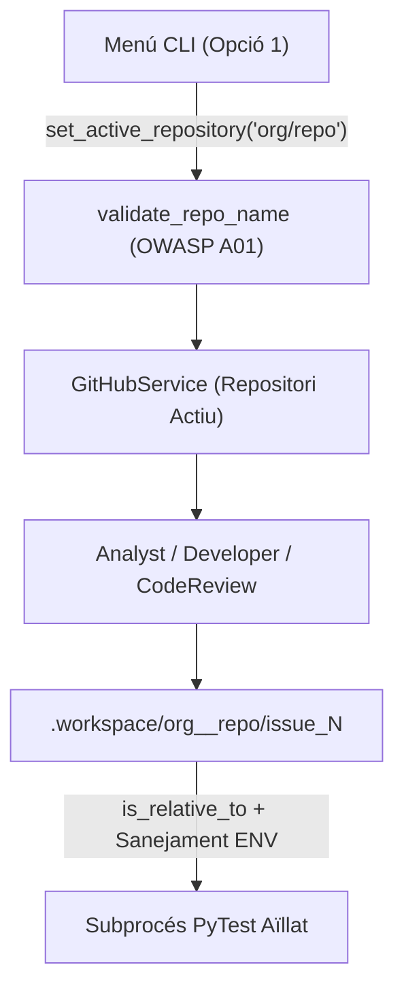

# ADR-0002: Gestió Multi-Repositori i Aïllament Segur de Workspaces

## 📋 Metadades i Traçabilitat de l'Agent d'IA

| Camp | Valor |
| :--- | :--- |
| **ID d'ADR** | `ADR-0002` |
| **Estat** | `Acceptat` |
| **Data** | `2026-10-27` |
| **Agent Autor** | `DeveloperAgent` / Equip de Seguretat |
| **Model LLM Emprat** | `gemini-2.5-flash` |
| **Repositori Actiu** | `emasnou/ai-developer-agent` (Multi-Repositori) |
| **Issue / PR Vinculada** | `Suport Multi-Repositori i GitHub Actions` |
| **Impacte de Seguretat (OWASP)** | `Alt — A01: Path Traversal i A05: Secret Isolation` |

---

## 1. Context i Problema Tècnic

- **Requeriment d'origen:** El sistema ha de permetre seleccionar des del menú interactiu sobre quin repositori de GitHub es vol treballar (d'una llista de repositoris disponibles), mostrar el repositori actiu a la capçalera del menú i executar totes les operacions d'anàlisi, desenvolupament, tests, GitHub Actions i auditoria sobre el repositori escollit.
- **Estat previ:** `GitHubService` estava lligat a una única variable `GITHUB_REPO` en inicialitzar-se i `DeveloperAgent` utilitzava una ruta única `.workspace/issue_<num>` copiant sempre el projecte local.
- **Restriccions aplicables:** Complir estrictament OWASP Top 10 ([`docs/code_policy.md`](../code_policy.md)) evitant contaminació entre repositoris, atacs de *Path Traversal* i filtració de credencials als subprocessos de test.

---

## 2. Factors de Decisió (Architectural Drivers)

* **Aïllament Multi-Repositori:** Garantir que el codi descarregat d'un repositori extern no es barregi amb els fitxers d'un altre repositori ni amb el codi font del propi `ai-developer-agent`.
* **Seguretat contra Path Traversal (OWASP A01):** Impedir que noms de repositori o rutes de fitxers generades pel LLM puguin escriure fora del directori `.workspace/` assignat.
* **Visibilitat de CI/CD (GitHub Actions):** Permetre que el `DeveloperAgent` llegeixi i modifiqui workflows `.github/workflows/*.yml` sense exposar el directori intern `.git/`.

---

## 3. Decisió d'Arquitectura Presa per l'Agent IA

### 3.1. Resum de la Solució Escollida
1. **Servei `GitHubService` amb estat de repositori dinàmic:** Permet inicialitzar-se sense repositori obligatori (`require_repo=False`), descobrir repositoris disponibles (`GITHUB_REPOS` + API de GitHub) i canviar el repositori actiu en calent (`set_active_repository`) validant el format amb `validate_repo_name`.
2. **Workspaces particionats per repositori i Issue:** `DeveloperAgent._prepare_workspace_environment` crea un espai aïllat sota `.workspace/<owner__repo>/issue_<num>` i verifica cada escriptura amb `target_path.resolve().is_relative_to(workspace_dir.resolve())`.
3. **Suport selectiu de `.github/workflows/`:** S'autoritza la sincronització de `.github/` a `get_repository_tree` tot mantenint bloquejats `.git/` i `.env`.

### 3.2. Diagrama d'Arquitectura / Flux (Mermaid)

### 3.3. Components i Fitxers Afectats
* [`src/utils/config.py`](../../src/utils/config.py): Suport per a `GITHUB_REPOS` i `parse_repo_list`.
* [`src/services/github_service.py`](../../src/services/github_service.py): Mètodes `validate_repo_name`, `list_available_repositories`, `set_active_repository` i `get_default_branch`.
* [`src/agents/developer_agent.py`](../../src/agents/developer_agent.py): Particionament de workspaces, lectura de `.github/workflows/` i protecció contra *Path Traversal*.
* [`src/main.py`](../../src/main.py): Menú interactiu amb capçalera de repositori actiu i Opció 1 de selecció.
* [`tests/unit/test_multi_repo.py`](../../tests/unit/test_multi_repo.py): Bateria de proves unitàries de seguretat, menú i aïllament.

---

## 4. Alternatives Considerades i Descartades

| Alternativa Avaluada | Avantatges (Pros) | Inconvenients (Contres) | Motiu de Descart per l'Agent IA |
| :--- | :--- | :--- | :--- |
| **Opció A (Escollida):** Instància `GitHubService` compartida amb canvi en calent i workspace `.workspace/<owner__repo>/` | Baix consum de recursos, aïllament net en disc i UX immediata al menú. | Cal gestionar l'estat `active_repo_name`. | **Seleccionada** per claredat arquitectònica i aïllament total entre repositoris. |
| **Opció B:** Reiniciar el procés Python modificant `.env` cada cop que es canvia de repositori | No requereix canvis als constructors dels agents. | Mala experiència d'usuari i risc de corrupció del fitxer `.env` local. | Descartada per violar el principi d'immutabilitat de configuració local. |
| **Opció C:** Compartir una única carpeta `.workspace/issue_<num>` per a tots els repositoris | Menys subdirectoris temporals. | Risc de col·lisió si dos repositoris tenen el mateix número d'Issue. | Descartada per risc de contaminació creuada de codi. |

---

## 5. Conseqüències, Trade-offs i Anàlisi de Seguretat (OWASP Top 10)

### 5.1. Conseqüències Positives
* ✅ Un únic procés interactiu pot gestionar el cicle complet de desenvolupament i CI/CD de qualsevol repositori de GitHub autoritzat.
* ✅ Visibilitat permanent del repositori actiu a la capçalera del menú CLI.

### 5.2. Trade-offs i Deute Tècnic Assumit
* ⚠️ Els tests executats al workspace utilitzen l'intèrpret Python de l'entorn amfitrió; si un repositori extern requereix dependències molt específiques no instal·lades a l'entorn base, en el futur es podria crear un `.venv` efímer per repositori.

### 5.3. Avaluació de Seguretat (OWASP Top 10)
* **A01 (Path Traversal):** Mitigat en dos punts: expressió regular estricta a `validate_repo_name` i comprovació `is_relative_to` a `_write_files_to_workspace`.
* **A05 (Secret Isolation):** Mitigat a `_build_workspace_env` eliminant `GITHUB_TOKEN`, `GEMINI_API_KEY` i `OPENAI_API_KEY` abans d'invocar `pytest`.

---

## 6. Verificació Automatitzada i Evidència de QA (PyTest)

* **Tests unitaris executats:** [`tests/unit/test_multi_repo.py`](../../tests/unit/test_multi_repo.py).
* **Aïllament verificat:** Proves executades amb `tmp_path`, `monkeypatch` i `MagicMock` sense accés a la xarxa.
* **Criteri d'acceptació per al `CodeReviewAgent`:** Tota escriptura de fitxers provinent d'una resposta del LLM ha de passar obligatòriament per `_write_files_to_workspace` amb verificació de ruta relativa.

