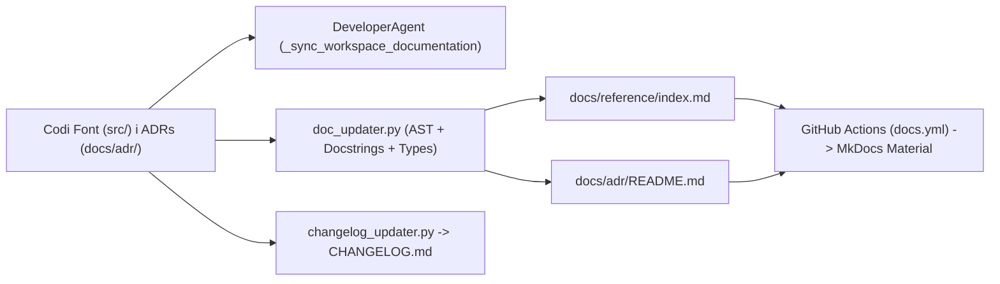

# 🤖 Portal de Documentació — AI Developer Agent

Benvingut al portal central de documentació d'**AI Developer Agent** (*Docs-as-Code*). Aquesta plataforma d'agents autònoms multi-repositori transforma requeriments funcionals en Issues de GitHub, desenvolupa i valida el codi en workspaces aïllats amb PyTest, audita les Pull Requests segons PEP 8 i OWASP Top 10, i **sincronitza automàticament tota la seva documentació tècnica**.

---

## 🧭 Estructura del Portal (Marc Diátaxis)

La documentació d'aquest projecte està estructurada seguint el marc **Diátaxis** i s'actualitza de manera 100% desatesa a cada canvi de codi:

| Dimensió Diátaxis | Objectiu | Documents Principals |
| :--- | :--- | :--- |
| **1. Tutorials i Quickstart** | Posada en marxa ràpida en menys de 5 minuts | Guia d'instal·lació i execució al `README.md` |
| **2. Guies Operatives (*How-To*)** | Flux de treball, plantilles i contribució | Guia de Contribució (`CONTRIBUTING.md`) i registre de versions (`CHANGELOG.md`) |
| **3. Referència Tècnica (*Reference*)** | Especificació d'API generada automàticament des del codi | [Referència d'API Auto-generada (`docs/reference/index.md`)](reference/index.md) |
| **4. Explicació i Governança (*Explanation*)** | Arquitectura, seguretat i decisions tècniques | [Política de Codi (`docs/code_policy.md`)](code_policy.md), [Política de Documentació](Politica_Documentacio.md) i [Registre d'ADRs (`docs/adr/README.md`)](adr/README.md) |

---

## 🏗️ Flux d'Automatització Documental (Zero-Touch Docs)

El sistema garanteix que la documentació no caduqui mai mitjançant quatre mecanismes automàtics integrats al cicle de vida de desenvolupament:

1. **Sincronització Autònoma a l'Agent (`DeveloperAgent`)**: Abans d'obrir o actualitzar qualsevol Pull Request, l'agent executa automàticament `update_all_documentation` i `update_changelog_file` dins del workspace i inclou els fitxers actualitzats al commit.
2. **Validació Estàtica Obligatòria (CI Gate)**: El workflow `.github/workflows/ci.yml` executa Ruff amb regles `pydocstyle` (`D` — convenció Google) i `python -m src.utils.doc_updater --validate-docstrings`, bloquejant qualsevol PR amb funcions o classes sense docstring o sense anotacions de tipus PEP 484.
3. **Generació i Auto-Commit en CI/CD (`.github/workflows/docs.yml`)**: A cada *push* a `main`, GitHub Actions regenera `docs/reference/index.md` i l'índex d'ADRs a `docs/adr/README.md`, fa auto-commit si hi ha canvis i publica el portal amb **MkDocs Material + `mkdocstrings`** a GitHub Pages.
4. **Auditoria de Qualitat (`CodeReviewAgent`)**: L'agent auditor verifica que tot nou mètode públic i decisió arquitectònica estigui degudament documentat abans d'aprovar la Pull Request.

